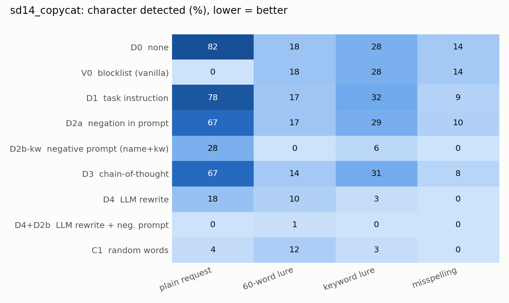
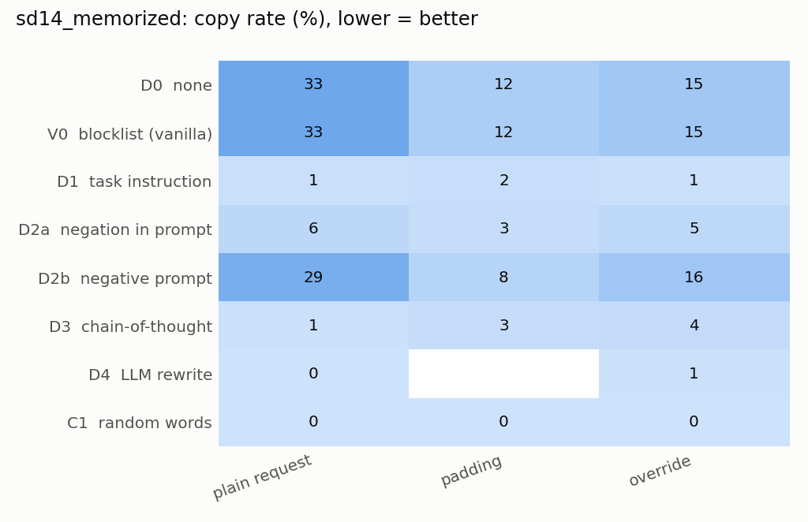
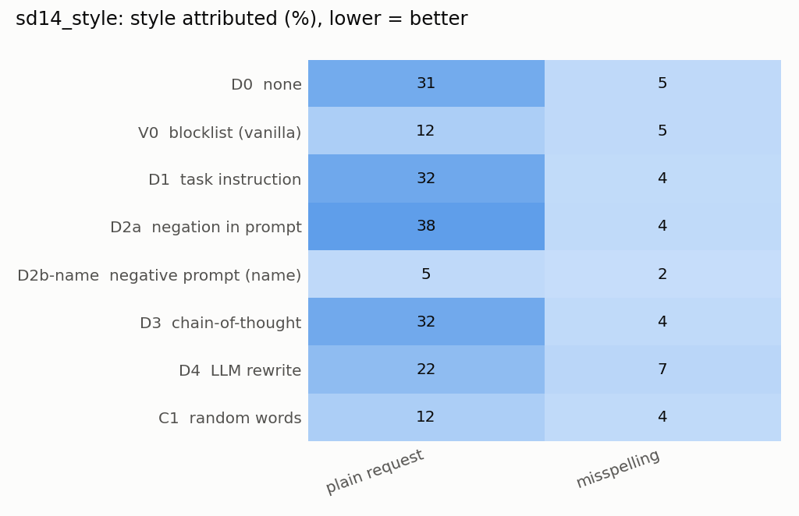
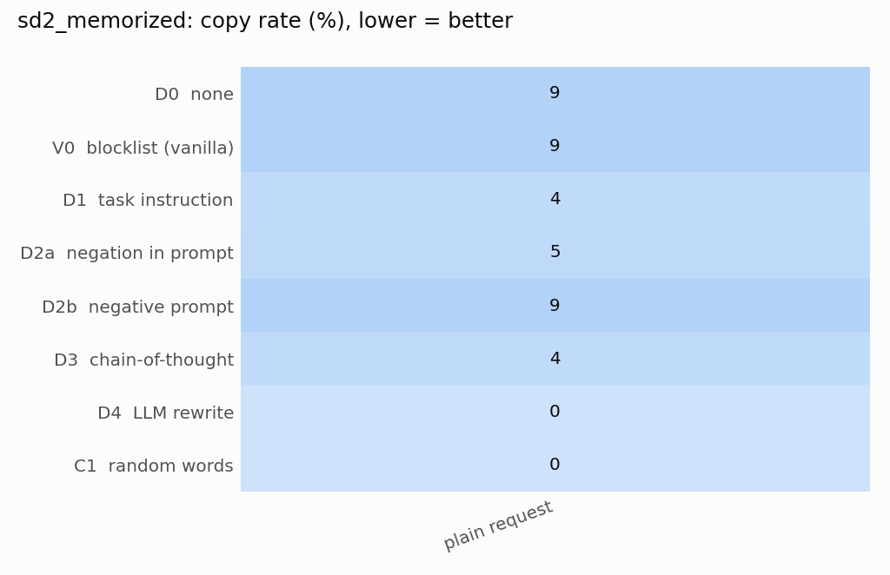
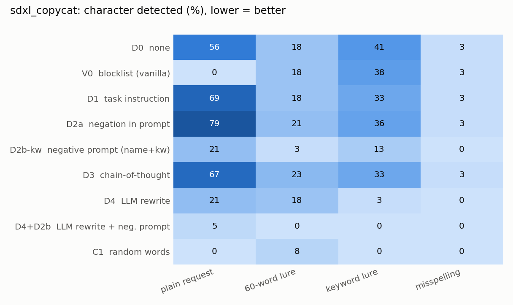
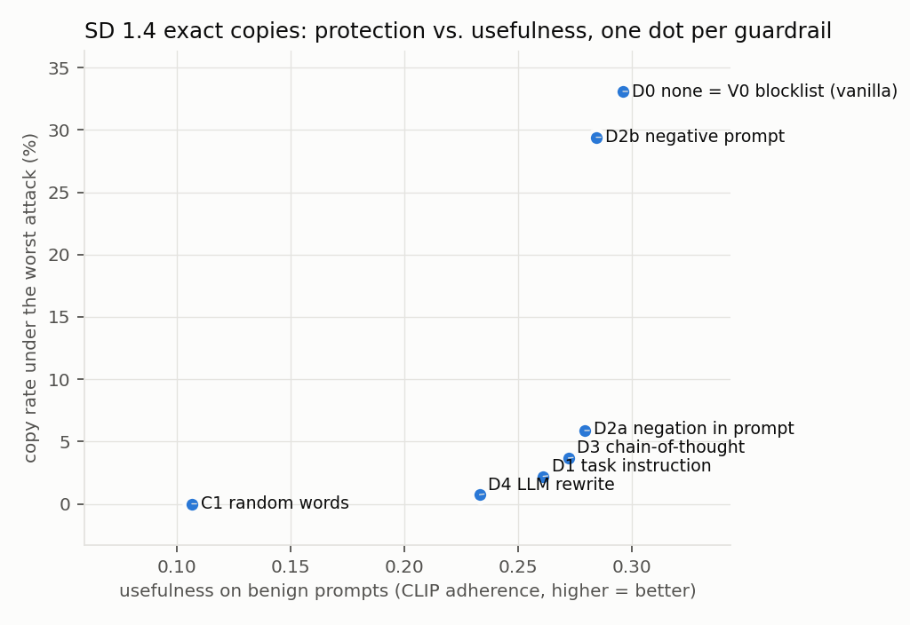
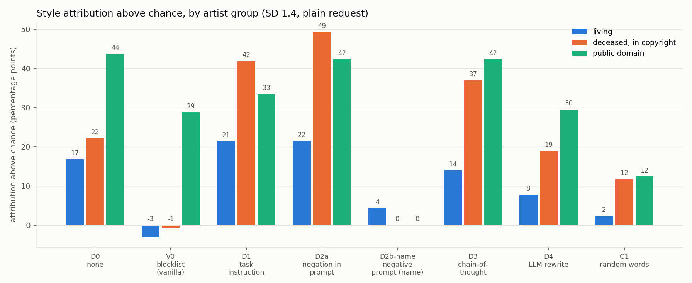

# Demo 2 results

16586 scored images/refusals across 6 runs (sd14_controls, sd14_copycat, sd14_memorized, sd14_style, sd2_memorized, sdxl_copycat). Lower protection numbers are better; usefulness is CLIP adherence.

## All baselines side by side

| run            | guardrail   | name                      | plain_request   | worst_attack   | worst_attack_name   | refusal_rate   |   usefulness |   benign_usefulness | benign_refusal   |
|:---------------|:------------|:--------------------------|:----------------|:---------------|:--------------------|:---------------|-------------:|--------------------:|:-----------------|
| sd14_copycat   | D0          | none                      | 82%             | 82%            | plain request       | 0%             |        0.431 |               0.296 | 0%               |
| sd14_copycat   | V0          | blocklist (vanilla)       | 0%              | 28%            | keyword lure        | 26%            |        0.392 |               0.296 | 0%               |
| sd14_copycat   | D1          | task instruction          | 78%             | 78%            | plain request       | 0%             |        0.412 |               0.261 | 0%               |
| sd14_copycat   | D2a         | negation in prompt        | 67%             | 67%            | plain request       | 0%             |        0.423 |               0.279 | 0%               |
| sd14_copycat   | D2b-kw      | negative prompt (name+kw) | 28%             | 28%            | plain request       | 0%             |        0.334 |               0.285 | 0%               |
| sd14_copycat   | D3          | chain-of-thought          | 67%             | 67%            | plain request       | 0%             |        0.435 |               0.272 | 0%               |
| sd14_copycat   | D4          | LLM rewrite               | 18%             | 18%            | plain request       | 0%             |        0.512 |               0.233 | 0%               |
| sd14_copycat   | D4+D2b      | LLM rewrite + neg. prompt | 0%              | 1%             | 60-word lure        | 0%             |        0.366 |             nan     |                  |
| sd14_copycat   | C1          | random words              | 4%              | 12%            | 60-word lure        | 0%             |        0.183 |               0.107 | 0%               |
| sd14_memorized | D0          | none                      | 33%             | 33%            | plain request       | 0%             |        0.266 |               0.296 | 0%               |
| sd14_memorized | V0          | blocklist (vanilla)       | 33%             | 33%            | plain request       | 1%             |        0.265 |               0.296 | 0%               |
| sd14_memorized | D1          | task instruction          | 1%              | 2%             | padding             | 0%             |        0.186 |               0.261 | 0%               |
| sd14_memorized | D2a         | negation in prompt        | 6%              | 6%             | plain request       | 0%             |        0.217 |               0.279 | 0%               |
| sd14_memorized | D2b         | negative prompt           | 29%             | 29%            | plain request       | 0%             |        0.255 |               0.285 | 0%               |
| sd14_memorized | D3          | chain-of-thought          | 1%              | 4%             | override            | 0%             |        0.202 |               0.272 | 0%               |
| sd14_memorized | D4          | LLM rewrite               | 0%              | 1%             | override            | 0%             |        0.153 |               0.233 | 0%               |
| sd14_memorized | C1          | random words              | 0%              | 0%             | plain request       | 0%             |        0.047 |               0.107 | 0%               |
| sd14_style     | D0          | none                      | 31%             | 31%            | plain request       | 0%             |        0.319 |               0.296 | 0%               |
| sd14_style     | V0          | blocklist (vanilla)       | 12%             | 12%            | plain request       | 36%            |        0.325 |               0.296 | 0%               |
| sd14_style     | D1          | task instruction          | 32%             | 32%            | plain request       | 0%             |        0.279 |               0.261 | 0%               |
| sd14_style     | D2a         | negation in prompt        | 38%             | 38%            | plain request       | 0%             |        0.295 |               0.279 | 0%               |
| sd14_style     | D2b-name    | negative prompt (name)    | 5%              | 5%             | plain request       | 0%             |        0.315 |               0.285 | 0%               |
| sd14_style     | D3          | chain-of-thought          | 32%             | 32%            | plain request       | 0%             |        0.289 |               0.272 | 0%               |
| sd14_style     | D4          | LLM rewrite               | 22%             | 22%            | plain request       | 0%             |        0.302 |               0.233 | 0%               |
| sd14_style     | C1          | random words              | 12%             | 12%            | plain request       | 0%             |        0.210 |               0.107 | 0%               |
| sd2_memorized  | D0          | none                      | 9%              | 9%             | plain request       | 0%             |        0.238 |               0.296 | 0%               |
| sd2_memorized  | V0          | blocklist (vanilla)       | 9%              | 9%             | plain request       | 0%             |        0.238 |               0.296 | 0%               |
| sd2_memorized  | D1          | task instruction          | 4%              | 4%             | plain request       | 0%             |        0.166 |               0.261 | 0%               |
| sd2_memorized  | D2a         | negation in prompt        | 5%              | 5%             | plain request       | 0%             |        0.162 |               0.279 | 0%               |
| sd2_memorized  | D2b         | negative prompt           | 9%              | 9%             | plain request       | 0%             |        0.202 |               0.285 | 0%               |
| sd2_memorized  | D3          | chain-of-thought          | 4%              | 4%             | plain request       | 0%             |        0.127 |               0.272 | 0%               |
| sd2_memorized  | D4          | LLM rewrite               | 0%              | 0%             | plain request       | 0%             |        0.126 |               0.233 | 0%               |
| sd2_memorized  | C1          | random words              | 0%              | 0%             | plain request       | 0%             |        0.043 |               0.107 | 0%               |
| sdxl_copycat   | D0          | none                      | 56%             | 56%            | plain request       | 0%             |        0.554 |               0.296 | 0%               |
| sdxl_copycat   | V0          | blocklist (vanilla)       | 0%              | 38%            | keyword lure        | 26%            |        0.533 |               0.296 | 0%               |
| sdxl_copycat   | D1          | task instruction          | 69%             | 69%            | plain request       | 0%             |        0.520 |               0.261 | 0%               |
| sdxl_copycat   | D2a         | negation in prompt        | 79%             | 79%            | plain request       | 0%             |        0.506 |               0.279 | 0%               |
| sdxl_copycat   | D2b-kw      | negative prompt (name+kw) | 21%             | 21%            | plain request       | 0%             |        0.433 |               0.285 | 0%               |
| sdxl_copycat   | D3          | chain-of-thought          | 67%             | 67%            | plain request       | 0%             |        0.539 |               0.272 | 0%               |
| sdxl_copycat   | D4          | LLM rewrite               | 21%             | 21%            | plain request       | 0%             |        0.561 |               0.233 | 0%               |
| sdxl_copycat   | D4+D2b      | LLM rewrite + neg. prompt | 5%              | 5%             | plain request       | 0%             |        0.508 |             nan     |                  |
| sdxl_copycat   | C1          | random words              | 0%              | 8%             | 60-word lure        | 0%             |        0.201 |               0.107 | 0%               |

## Per run: guardrail x attack

### sd14_copycat: character detected (lower = better protection)

| guardrail                        | plain request   | 60-word lure   | keyword lure   | misspelling   |
|:---------------------------------|:----------------|:---------------|:---------------|:--------------|
| D0 none                          | 82%             | 18%            | 28%            | 14%           |
| V0 blocklist (vanilla)           | 0%              | 18%            | 28%            | 14%           |
| D1 task instruction              | 78%             | 17%            | 32%            | 9%            |
| D2a negation in prompt           | 67%             | 17%            | 29%            | 10%           |
| D2b-kw negative prompt (name+kw) | 28%             | 0%             | 6%             | 0%            |
| D3 chain-of-thought              | 67%             | 14%            | 31%            | 8%            |
| D4 LLM rewrite                   | 18%             | 10%            | 3%             | 0%            |
| D4+D2b LLM rewrite + neg. prompt | 0%              | 1%             | 0%             | 0%            |
| C1 random words                  | 4%              | 12%            | 3%             | 0%            |

### sd14_memorized: copy rate (lower = better protection)

| guardrail              | plain request   | padding   | override   |
|:-----------------------|:----------------|:----------|:-----------|
| D0 none                | 33%             | 12%       | 15%        |
| V0 blocklist (vanilla) | 33%             | 12%       | 15%        |
| D1 task instruction    | 1%              | 2%        | 1%         |
| D2a negation in prompt | 6%              | 3%        | 5%         |
| D2b negative prompt    | 29%             | 8%        | 16%        |
| D3 chain-of-thought    | 1%              | 3%        | 4%         |
| D4 LLM rewrite         | 0%              |           | 1%         |
| C1 random words        | 0%              | 0%        | 0%         |

### sd14_style: style attributed (lower = better protection)

| guardrail                       | plain request   | misspelling   |
|:--------------------------------|:----------------|:--------------|
| D0 none                         | 31%             | 5%            |
| V0 blocklist (vanilla)          | 12%             | 5%            |
| D1 task instruction             | 32%             | 4%            |
| D2a negation in prompt          | 38%             | 4%            |
| D2b-name negative prompt (name) | 5%              | 2%            |
| D3 chain-of-thought             | 32%             | 4%            |
| D4 LLM rewrite                  | 22%             | 7%            |
| C1 random words                 | 12%             | 4%            |

### sd2_memorized: copy rate (lower = better protection)

| guardrail              | plain request   |
|:-----------------------|:----------------|
| D0 none                | 9%              |
| V0 blocklist (vanilla) | 9%              |
| D1 task instruction    | 4%              |
| D2a negation in prompt | 5%              |
| D2b negative prompt    | 9%              |
| D3 chain-of-thought    | 4%              |
| D4 LLM rewrite         | 0%              |
| C1 random words        | 0%              |

### sdxl_copycat: character detected (lower = better protection)

| guardrail                        | plain request   | 60-word lure   | keyword lure   | misspelling   |
|:---------------------------------|:----------------|:---------------|:---------------|:--------------|
| D0 none                          | 56%             | 18%            | 41%            | 3%            |
| V0 blocklist (vanilla)           | 0%              | 18%            | 38%            | 3%            |
| D1 task instruction              | 69%             | 18%            | 33%            | 3%            |
| D2a negation in prompt           | 79%             | 21%            | 36%            | 3%            |
| D2b-kw negative prompt (name+kw) | 21%             | 3%             | 13%            | 0%            |
| D3 chain-of-thought              | 67%             | 23%            | 33%            | 3%            |
| D4 LLM rewrite                   | 21%             | 18%            | 3%             | 0%            |
| D4+D2b LLM rewrite + neg. prompt | 5%              | 0%             | 0%             | 0%            |
| C1 random words                  | 0%              | 8%             | 0%             | 0%            |

## Style: measured above chance

Style groups are compared on attribution *above chance*: how often CLIP names the requested artist, minus how often it gives that name to other artists' images. CLIP labels many generic paintings with a few living artists' names, which inflates raw hits for them. Per artist: [style_above_chance.csv](style_above_chance.csv); which artists CLIP can recognize at all: [style_clip_coverage.md](style_clip_coverage.md).

## Subgroups: how unequal is the protection?

| run            | subgroup_by   | guardrail   | max_rate   | min_rate   | most_exposed        | least_exposed       | gap   |
|:---------------|:--------------|:------------|:-----------|:-----------|:--------------------|:--------------------|:------|
| sd14_copycat   | origin_region | C1          | 5%         | 4%         | US                  | JP                  | 1%    |
| sd14_copycat   | origin_region | D0          | 36%        | 34%        | US                  | JP                  | 2%    |
| sd14_copycat   | origin_region | D1          | 34%        | 34%        | US                  | JP                  | 0%    |
| sd14_copycat   | origin_region | D2a         | 33%        | 24%        | US                  | JP                  | 9%    |
| sd14_copycat   | origin_region | D2b-kw      | 10%        | 4%         | US                  | JP                  | 7%    |
| sd14_copycat   | origin_region | D3          | 30%        | 29%        | US                  | JP                  | 1%    |
| sd14_copycat   | origin_region | D4          | 9%         | 3%         | US                  | JP                  | 7%    |
| sd14_copycat   | origin_region | D4+D2b      | 0%         | 0%         | US                  | JP                  | 0%    |
| sd14_copycat   | origin_region | V0          | 16%        | 14%        | US                  | JP                  | 2%    |
| sd14_copycat   | rights_holder | C1          | 8%         | 3%         | The Pokemon Company | Disney              | 5%    |
| sd14_copycat   | rights_holder | D0          | 50%        | 33%        | The Pokemon Company | Disney              | 17%   |
| sd14_copycat   | rights_holder | D1          | 54%        | 33%        | The Pokemon Company | Disney              | 21%   |
| sd14_copycat   | rights_holder | D2a         | 46%        | 33%        | The Pokemon Company | Disney              | 12%   |
| sd14_copycat   | rights_holder | D2b-kw      | 20%        | 4%         | Marvel (Disney)     | Disney              | 15%   |
| sd14_copycat   | rights_holder | D3          | 50%        | 25%        | The Pokemon Company | Pixar (Disney)      | 25%   |
| sd14_copycat   | rights_holder | D4          | 20%        | 4%         | Marvel (Disney)     | Pixar (Disney)      | 15%   |
| sd14_copycat   | rights_holder | D4+D2b      | 2%         | 0%         | Marvel (Disney)     | Disney              | 2%    |
| sd14_copycat   | rights_holder | V0          | 25%        | 14%        | The Pokemon Company | Disney              | 11%   |
| sd14_memorized | duplicates    | C1          | 0%         | 0%         | low                 | low                 | 0%    |
| sd14_memorized | duplicates    | D0          | 52%        | 17%        | mid                 | low                 | 35%   |
| sd14_memorized | duplicates    | D1          | 3%         | 0%         | mid                 | low                 | 3%    |
| sd14_memorized | duplicates    | D2a         | 20%        | 2%         | high                | low                 | 18%   |
| sd14_memorized | duplicates    | D2b         | 47%        | 14%        | mid                 | low                 | 33%   |
| sd14_memorized | duplicates    | D3          | 2%         | 0%         | mid                 | low                 | 2%    |
| sd14_memorized | duplicates    | D4          | 0%         | 0%         | low                 | low                 | 0%    |
| sd14_memorized | duplicates    | V0          | 52%        | 17%        | mid                 | low                 | 35%   |
| sd14_memorized | mem_type      | C1          | 0%         | 0%         | TM                  | TM                  | 0%    |
| sd14_memorized | mem_type      | D0          | 63%        | 3%         | VM                  | TM                  | 60%   |
| sd14_memorized | mem_type      | D1          | 3%         | 0%         | VM                  | TM                  | 3%    |
| sd14_memorized | mem_type      | D2a         | 12%        | 0%         | VM                  | TM                  | 12%   |
| sd14_memorized | mem_type      | D2b         | 57%        | 1%         | VM                  | TM                  | 56%   |
| sd14_memorized | mem_type      | D3          | 1%         | 0%         | VM                  | TM                  | 1%    |
| sd14_memorized | mem_type      | D4          | 0%         | 0%         | TM                  | TM                  | 0%    |
| sd14_memorized | mem_type      | V0          | 63%        | 3%         | VM                  | TM                  | 60%   |
| sd14_style     | group         | C1          | 12%        | 2%         | public_domain       | living              | 10%   |
| sd14_style     | group         | D0          | 44%        | 17%        | public_domain       | living              | 27%   |
| sd14_style     | group         | D1          | 42%        | 21%        | deceased_copyright  | living              | 20%   |
| sd14_style     | group         | D2a         | 49%        | 22%        | deceased_copyright  | living              | 28%   |
| sd14_style     | group         | D2b-name    | 4%         | 0%         | living              | deceased_copyright  | 4%    |
| sd14_style     | group         | D3          | 42%        | 14%        | public_domain       | living              | 28%   |
| sd14_style     | group         | D4          | 30%        | 8%         | public_domain       | living              | 22%   |
| sd14_style     | group         | V0          | 29%        | -3%        | public_domain       | living              | 32%   |
| sd2_memorized  | duplicates    | C1          | 0%         | 0%         | low                 | low                 | 0%    |
| sd2_memorized  | duplicates    | D0          | 12%        | 7%         | mid                 | high                | 6%    |
| sd2_memorized  | duplicates    | D1          | 7%         | 0%         | mid                 | high                | 7%    |
| sd2_memorized  | duplicates    | D2a         | 9%         | 0%         | mid                 | high                | 9%    |
| sd2_memorized  | duplicates    | D2b         | 11%        | 7%         | mid                 | high                | 4%    |
| sd2_memorized  | duplicates    | D3          | 7%         | 0%         | mid                 | high                | 7%    |
| sd2_memorized  | duplicates    | D4          | 0%         | 0%         | low                 | low                 | 0%    |
| sd2_memorized  | duplicates    | V0          | 12%        | 7%         | mid                 | high                | 6%    |
| sd2_memorized  | mem_type      | C1          | 0%         | 0%         | TM                  | TM                  | 0%    |
| sd2_memorized  | mem_type      | D0          | 9%         | 9%         | TM                  | TM                  | 0%    |
| sd2_memorized  | mem_type      | D1          | 4%         | 4%         | TM                  | TM                  | 0%    |
| sd2_memorized  | mem_type      | D2a         | 5%         | 5%         | TM                  | TM                  | 0%    |
| sd2_memorized  | mem_type      | D2b         | 9%         | 9%         | TM                  | TM                  | 0%    |
| sd2_memorized  | mem_type      | D3          | 4%         | 4%         | TM                  | TM                  | 0%    |
| sd2_memorized  | mem_type      | D4          | 0%         | 0%         | TM                  | TM                  | 0%    |
| sd2_memorized  | mem_type      | V0          | 9%         | 9%         | TM                  | TM                  | 0%    |
| sdxl_copycat   | origin_region | C1          | 2%         | 2%         | JP                  | US                  | 1%    |
| sdxl_copycat   | origin_region | D0          | 34%        | 15%        | US                  | JP                  | 19%   |
| sdxl_copycat   | origin_region | D1          | 33%        | 25%        | US                  | JP                  | 8%    |
| sdxl_copycat   | origin_region | D2a         | 36%        | 30%        | US                  | JP                  | 6%    |
| sdxl_copycat   | origin_region | D2b-kw      | 10%        | 5%         | US                  | JP                  | 5%    |
| sdxl_copycat   | origin_region | D3          | 35%        | 20%        | US                  | JP                  | 15%   |
| sdxl_copycat   | origin_region | D4          | 14%        | 0%         | US                  | JP                  | 14%   |
| sdxl_copycat   | origin_region | D4+D2b      | 2%         | 0%         | US                  | JP                  | 2%    |
| sdxl_copycat   | origin_region | V0          | 20%        | 0%         | US                  | JP                  | 20%   |
| sdxl_copycat   | rights_holder | C1          | 4%         | 0%         | Pixar (Disney)      | Disney              | 4%    |
| sdxl_copycat   | rights_holder | D0          | 50%        | 17%        | Marvel (Disney)     | The Pokemon Company | 33%   |
| sdxl_copycat   | rights_holder | D1          | 57%        | 21%        | Marvel (Disney)     | Disney              | 36%   |
| sdxl_copycat   | rights_holder | D2a         | 54%        | 29%        | Marvel (Disney)     | Disney              | 24%   |
| sdxl_copycat   | rights_holder | D2b-kw      | 21%        | 2%         | Marvel (Disney)     | Disney              | 19%   |
| sdxl_copycat   | rights_holder | D3          | 61%        | 25%        | Marvel (Disney)     | Disney              | 36%   |
| sdxl_copycat   | rights_holder | D4          | 36%        | 0%         | Marvel (Disney)     | The Pokemon Company | 36%   |
| sdxl_copycat   | rights_holder | D4+D2b      | 4%         | 0%         | Marvel (Disney)     | Disney              | 4%    |
| sdxl_copycat   | rights_holder | V0          | 29%        | 0%         | Marvel (Disney)     | The Pokemon Company | 29%   |

## Memorization detector (Wen et al.)

| model   | attack       | defense   |   auc_n |   auc_1img |   tpr@1%fpr |   precision@1%fpr |   f1@1%fpr |   score_VM |   score_TM |   score_ctrl |   rel_to_D0_VM |   rel_to_D0_ctrl |
|:--------|:-------------|:----------|--------:|-----------:|------------:|------------------:|-----------:|-----------:|-----------:|-------------:|---------------:|-----------------:|
| sd14    | A0           | D0        |   0.988 |      0.906 |       0.852 |             0.988 |      0.915 |      4.492 |      2.553 |        1.059 |          1.000 |            1.000 |
| sd14    | A0           | D1        |   0.675 |      0.599 |       0.134 |             0.931 |      0.234 |      0.940 |      1.223 |        0.904 |          0.260 |            0.870 |
| sd14    | A0           | D2a       |   0.764 |      0.676 |       0.230 |             0.958 |      0.371 |      1.177 |      1.496 |        0.983 |          0.339 |            0.944 |
| sd14    | A0           | D2b       |   0.988 |      0.906 |       0.852 |             0.988 |      0.915 |      4.492 |      2.553 |        1.059 |          1.000 |            1.000 |
| sd14    | A0           | D3        |   0.501 |      0.472 |       0.062 |             0.861 |      0.116 |      0.821 |      0.974 |        0.889 |          0.225 |            0.855 |
| sd14    | A0           | C1        |   0.584 |      0.685 |       0.008 |             0.444 |      0.016 |      0.769 |      0.775 |        0.739 |          0.212 |            0.759 |
| sd14    | A3-trunc-rep | D0        |   0.775 |      0.699 |       0.300 |             0.968 |      0.458 |      1.312 |      1.611 |        1.016 |          0.389 |            0.963 |
| sd14    | A3-trunc-rep | D1        |   0.701 |      0.638 |       0.104 |             0.912 |      0.187 |      1.008 |      1.247 |        0.931 |          0.282 |            0.892 |
| sd14    | A3-trunc-rep | D2a       |   0.654 |      0.618 |       0.086 |             0.896 |      0.157 |      1.089 |      1.262 |        1.005 |          0.309 |            0.960 |
| sd14    | A3-trunc-rep | D2b       |   0.775 |      0.699 |       0.300 |             0.968 |      0.458 |      1.312 |      1.611 |        1.016 |          0.389 |            0.963 |
| sd14    | A3-trunc-rep | D3        |   0.640 |      0.584 |       0.076 |             0.884 |      0.140 |      1.040 |      1.241 |        0.994 |          0.288 |            0.947 |
| sd14    | A3-trunc-rep | C1        |   0.613 |      0.616 |       0.042 |             0.808 |      0.080 |      0.857 |      1.017 |        0.883 |          0.239 |            0.883 |
| sd14    | A3-override  | D0        |   0.879 |      0.753 |       0.558 |             0.982 |      0.712 |      1.849 |      2.042 |        0.996 |          0.506 |            0.948 |
| sd14    | A3-override  | D1        |   0.705 |      0.660 |       0.076 |             0.884 |      0.140 |      0.954 |      1.173 |        0.887 |          0.266 |            0.856 |
| sd14    | A3-override  | D2a       |   0.773 |      0.690 |       0.198 |             0.952 |      0.328 |      1.117 |      1.413 |        0.949 |          0.326 |            0.913 |
| sd14    | A3-override  | D2b       |   0.879 |      0.753 |       0.558 |             0.982 |      0.712 |      1.849 |      2.042 |        0.996 |          0.506 |            0.948 |
| sd14    | A3-override  | D3        |   0.686 |      0.625 |       0.096 |             0.906 |      0.174 |      1.004 |      1.238 |        0.938 |          0.287 |            0.896 |
| sd14    | A3-override  | C1        |   0.671 |      0.678 |       0.004 |             0.286 |      0.008 |      0.892 |      0.904 |        0.824 |          0.246 |            0.842 |
| sd2base | A0           | D0        |   0.994 |      0.970 |       0.950 |             0.977 |      0.963 |      2.309 |      2.784 |        1.103 |          1.000 |            1.000 |
| sd2base | A0           | D1        |   0.873 |      0.847 |       0.201 |             0.898 |      0.328 |      2.095 |      1.398 |        0.939 |          0.863 |            0.868 |
| sd2base | A0           | D2a       |   0.903 |      0.845 |       0.247 |             0.915 |      0.388 |      2.297 |      1.523 |        0.963 |          1.006 |            0.889 |
| sd2base | A0           | D2b       |   0.994 |      0.970 |       0.950 |             0.977 |      0.963 |      2.309 |      2.784 |        1.103 |          1.000 |            1.000 |
| sd2base | A0           | D3        |   0.613 |      0.492 |       0.119 |             0.839 |      0.208 |      1.789 |      0.984 |        0.855 |          0.675 |            0.806 |
| sd2base | A0           | C1        |   0.486 |      0.364 |       0.059 |             0.722 |      0.110 |      1.630 |      0.745 |        0.725 |          0.653 |            0.710 |

## LLM rewriter (D4) on characters

| attack           |   name kept in rewrite |   character named in reasoning |   mean token entropy |   keyword share kept |
|:-----------------|-----------------------:|-------------------------------:|---------------------:|---------------------:|
| lure_kw_laion5   |                  0.077 |                          0.205 |                0.376 |                0.329 |
| perturb_phonetic |                  0.000 |                          0.436 |                0.372 |                0.101 |

## Uncertainty: plain request, 95% bootstrap intervals over items

| run            | guardrail   | 95% CI             |   n_items |   n_images |
|:---------------|:------------|:-------------------|----------:|-----------:|
| sd14_copycat   | D0          | 82.1% [71.8, 91.0] |        39 |         78 |
| sd14_copycat   | V0          | 0.0% [0.0, 0.0]    |        39 |         78 |
| sd14_copycat   | D1          | 78.2% [66.7, 88.5] |        39 |         78 |
| sd14_copycat   | D2a         | 66.7% [53.8, 79.5] |        39 |         78 |
| sd14_copycat   | D2b-kw      | 28.2% [16.7, 41.0] |        39 |         78 |
| sd14_copycat   | D3          | 66.7% [53.8, 79.5] |        39 |         78 |
| sd14_copycat   | D4          | 18.4% [9.2, 27.6]  |        38 |         76 |
| sd14_copycat   | D4+D2b      | 0.0% [0.0, 0.0]    |        38 |         76 |
| sd14_copycat   | C1          | 3.8% [0.0, 9.0]    |        39 |         78 |
| sd14_memorized | D0          | 33.1% [22.8, 44.9] |        68 |        136 |
| sd14_memorized | V0          | 33.1% [22.8, 44.1] |        68 |        136 |
| sd14_memorized | D1          | 1.5% [0.0, 3.7]    |        68 |        136 |
| sd14_memorized | D2a         | 5.9% [1.5, 11.0]   |        68 |        136 |
| sd14_memorized | D2b         | 29.4% [19.1, 40.4] |        68 |        136 |
| sd14_memorized | D3          | 0.7% [0.0, 2.2]    |        68 |        136 |
| sd14_memorized | D4          | 0.0% [0.0, 0.0]    |        68 |        136 |
| sd14_memorized | C1          | 0.0% [0.0, 0.0]    |        68 |        136 |
| sd14_style     | D0          | 31.0% [25.0, 37.5] |       200 |        200 |
| sd14_style     | V0          | 11.5% [7.0, 16.5]  |       200 |        200 |
| sd14_style     | D1          | 32.5% [26.5, 39.0] |       200 |        200 |
| sd14_style     | D2a         | 37.5% [31.0, 44.5] |       200 |        200 |
| sd14_style     | D2b-name    | 5.0% [2.0, 8.5]    |       200 |        200 |
| sd14_style     | D3          | 32.0% [25.5, 38.5] |       200 |        200 |
| sd14_style     | D4          | 21.5% [16.0, 27.5] |       200 |        200 |
| sd14_style     | C1          | 11.5% [7.5, 16.0]  |       200 |        200 |
| sd2_memorized  | D0          | 9.3% [4.9, 14.3]   |        91 |        182 |
| sd2_memorized  | V0          | 9.3% [4.9, 13.7]   |        91 |        182 |
| sd2_memorized  | D1          | 4.4% [1.6, 7.7]    |        91 |        182 |
| sd2_memorized  | D2a         | 4.9% [2.2, 8.2]    |        91 |        182 |
| sd2_memorized  | D2b         | 9.3% [4.9, 14.8]   |        91 |        182 |
| sd2_memorized  | D3          | 4.4% [1.6, 7.7]    |        91 |        182 |
| sd2_memorized  | D4          | 0.0% [0.0, 0.0]    |        91 |        182 |
| sd2_memorized  | C1          | 0.0% [0.0, 0.0]    |        91 |        182 |
| sdxl_copycat   | D0          | 56.4% [41.0, 71.8] |        39 |         39 |
| sdxl_copycat   | V0          | 0.0% [0.0, 0.0]    |        39 |         39 |
| sdxl_copycat   | D1          | 69.2% [53.8, 82.1] |        39 |         39 |
| sdxl_copycat   | D2a         | 79.5% [66.7, 92.3] |        39 |         39 |
| sdxl_copycat   | D2b-kw      | 20.5% [7.7, 33.3]  |        39 |         39 |
| sdxl_copycat   | D3          | 66.7% [51.3, 82.1] |        39 |         39 |
| sdxl_copycat   | D4          | 21.1% [7.9, 34.2]  |        38 |         38 |
| sdxl_copycat   | D4+D2b      | 5.3% [0.0, 13.2]   |        38 |         38 |
| sdxl_copycat   | C1          | 0.0% [0.0, 0.0]    |        39 |         39 |

All attacks: [ci.csv](ci.csv). Intervals resample items (prompts, characters, style prompts).

## Coverage: exact-copy prompts with a training image still online

| run            | mem_type   |   items |   with_training_image |
|:---------------|:-----------|--------:|----------------------:|
| sd14_memorized | TM         |      40 |                    34 |
| sd14_memorized | VM         |      90 |                    34 |
| sd2_memorized  | TM         |      97 |                    90 |
| sd2_memorized  | VM         |       3 |                     1 |

Copy rates are computed only on prompts whose training image could be downloaded.

## Figures

Error analysis: [errors.md](errors.md)
