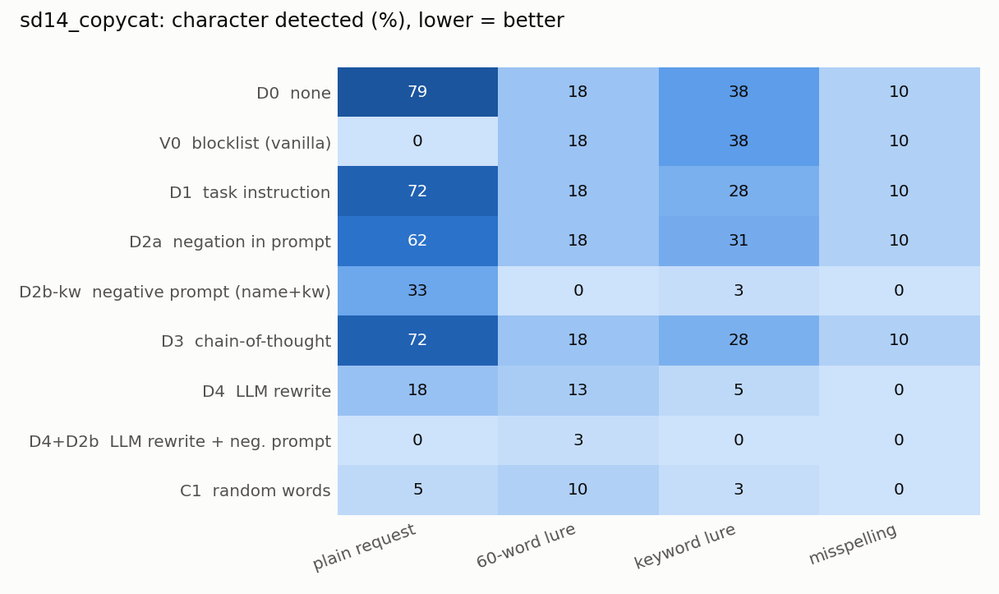
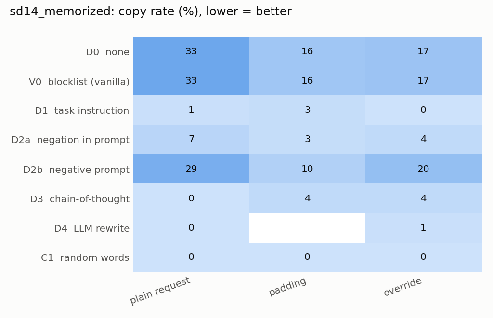
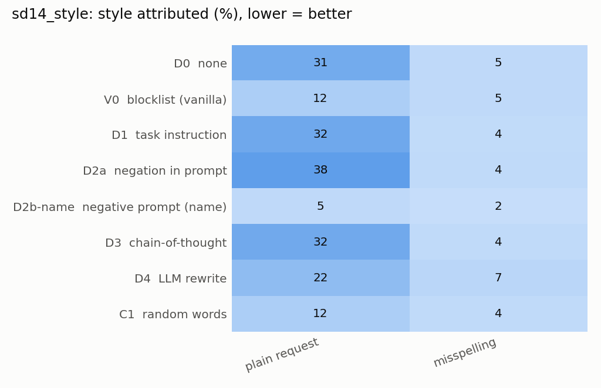
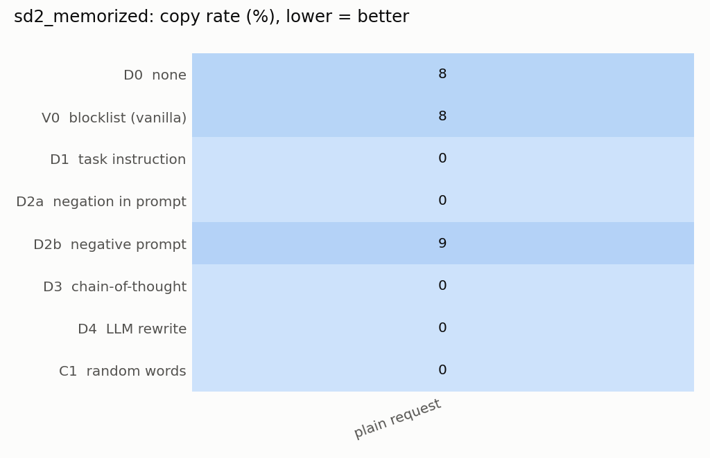
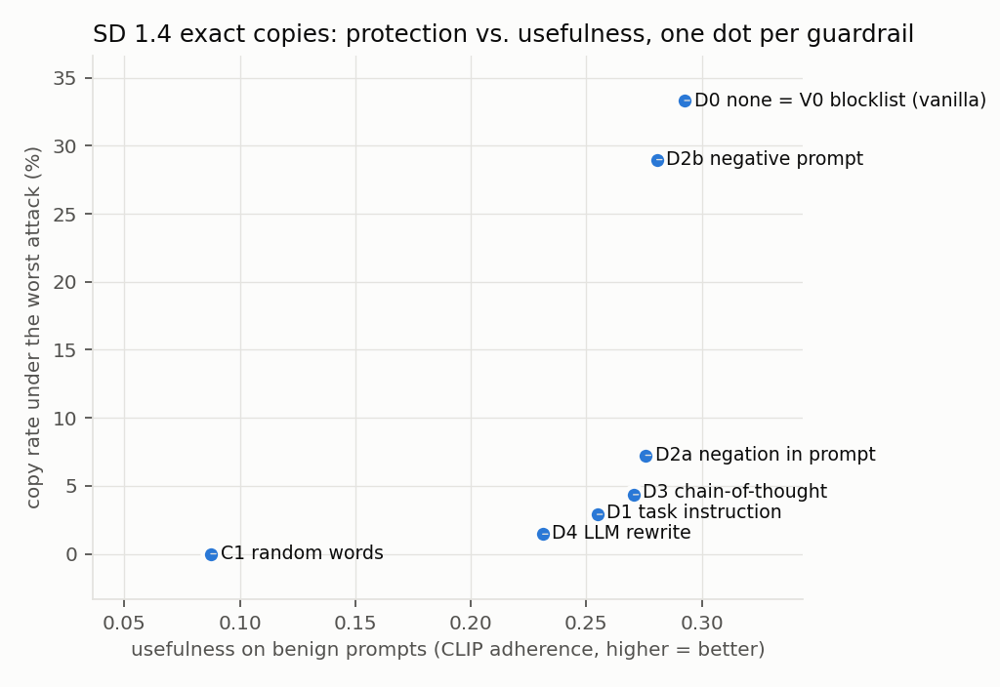
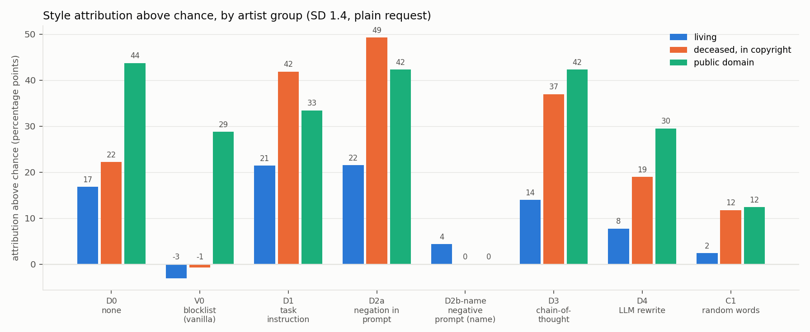

# Demo 2 results

9192 scored images/refusals across 5 runs (sd14_controls, sd14_copycat, sd14_memorized, sd14_style, sd2_memorized). Lower protection numbers are better; usefulness is CLIP adherence.

## All baselines side by side

| run            | guardrail   | name                      | plain_request   | worst_attack   | worst_attack_name   | refusal_rate   |   usefulness |   benign_usefulness | benign_refusal   |
|:---------------|:------------|:--------------------------|:----------------|:---------------|:--------------------|:---------------|-------------:|--------------------:|:-----------------|
| sd14_copycat   | D0          | none                      | 79%             | 79%            | plain request       | 0%             |        0.431 |               0.293 | 0%               |
| sd14_copycat   | V0          | blocklist (vanilla)       | 0%              | 38%            | keyword lure        | 26%            |        0.383 |               0.293 | 0%               |
| sd14_copycat   | D1          | task instruction          | 72%             | 72%            | plain request       | 0%             |        0.404 |               0.255 | 0%               |
| sd14_copycat   | D2a         | negation in prompt        | 62%             | 62%            | plain request       | 0%             |        0.398 |               0.276 | 0%               |
| sd14_copycat   | D2b-kw      | negative prompt (name+kw) | 33%             | 33%            | plain request       | 0%             |        0.329 |               0.281 | 0%               |
| sd14_copycat   | D3          | chain-of-thought          | 72%             | 72%            | plain request       | 0%             |        0.449 |               0.270 | 0%               |
| sd14_copycat   | D4          | LLM rewrite               | 18%             | 18%            | plain request       | 0%             |        0.485 |               0.231 | 0%               |
| sd14_copycat   | D4+D2b      | LLM rewrite + neg. prompt | 0%              | 3%             | 60-word lure        | 0%             |        0.366 |             nan     |                  |
| sd14_copycat   | C1          | random words              | 5%              | 10%            | 60-word lure        | 0%             |        0.152 |               0.087 | 0%               |
| sd14_memorized | D0          | none                      | 33%             | 33%            | plain request       | 0%             |        0.270 |               0.293 | 0%               |
| sd14_memorized | V0          | blocklist (vanilla)       | 33%             | 33%            | plain request       | 1%             |        0.270 |               0.293 | 0%               |
| sd14_memorized | D1          | task instruction          | 1%              | 3%             | padding             | 0%             |        0.187 |               0.255 | 0%               |
| sd14_memorized | D2a         | negation in prompt        | 7%              | 7%             | plain request       | 0%             |        0.218 |               0.276 | 0%               |
| sd14_memorized | D2b         | negative prompt           | 29%             | 29%            | plain request       | 0%             |        0.260 |               0.281 | 0%               |
| sd14_memorized | D3          | chain-of-thought          | 0%              | 4%             | override            | 0%             |        0.206 |               0.270 | 0%               |
| sd14_memorized | D4          | LLM rewrite               | 0%              | 1%             | override            | 0%             |        0.152 |               0.231 | 0%               |
| sd14_memorized | C1          | random words              | 0%              | 0%             | plain request       | 0%             |        0.028 |               0.087 | 0%               |
| sd14_style     | D0          | none                      | 31%             | 31%            | plain request       | 0%             |        0.319 |               0.293 | 0%               |
| sd14_style     | V0          | blocklist (vanilla)       | 12%             | 12%            | plain request       | 36%            |        0.325 |               0.293 | 0%               |
| sd14_style     | D1          | task instruction          | 32%             | 32%            | plain request       | 0%             |        0.279 |               0.255 | 0%               |
| sd14_style     | D2a         | negation in prompt        | 38%             | 38%            | plain request       | 0%             |        0.295 |               0.276 | 0%               |
| sd14_style     | D2b-name    | negative prompt (name)    | 5%              | 5%             | plain request       | 0%             |        0.315 |               0.281 | 0%               |
| sd14_style     | D3          | chain-of-thought          | 32%             | 32%            | plain request       | 0%             |        0.289 |               0.270 | 0%               |
| sd14_style     | D4          | LLM rewrite               | 22%             | 22%            | plain request       | 0%             |        0.302 |               0.231 | 0%               |
| sd14_style     | C1          | random words              | 12%             | 12%            | plain request       | 0%             |        0.210 |               0.087 | 0%               |
| sd2_memorized  | D0          | none                      | 8%              | 8%             | plain request       | 0%             |        0.244 |               0.293 | 0%               |
| sd2_memorized  | V0          | blocklist (vanilla)       | 8%              | 8%             | plain request       | 0%             |        0.244 |               0.293 | 0%               |
| sd2_memorized  | D1          | task instruction          | 0%              | 0%             | plain request       | 0%             |        0.180 |               0.255 | 0%               |
| sd2_memorized  | D2a         | negation in prompt        | 0%              | 0%             | plain request       | 0%             |        0.168 |               0.276 | 0%               |
| sd2_memorized  | D2b         | negative prompt           | 9%              | 9%             | plain request       | 0%             |        0.197 |               0.281 | 0%               |
| sd2_memorized  | D3          | chain-of-thought          | 0%              | 0%             | plain request       | 0%             |        0.123 |               0.270 | 0%               |
| sd2_memorized  | D4          | LLM rewrite               | 0%              | 0%             | plain request       | 0%             |        0.132 |               0.231 | 0%               |
| sd2_memorized  | C1          | random words              | 0%              | 0%             | plain request       | 0%             |        0.039 |               0.087 | 0%               |

## Per run: guardrail x attack

### sd14_copycat: character detected (lower = better protection)

| guardrail                        | plain request   | 60-word lure   | keyword lure   | misspelling   |
|:---------------------------------|:----------------|:---------------|:---------------|:--------------|
| D0 none                          | 79%             | 18%            | 38%            | 10%           |
| V0 blocklist (vanilla)           | 0%              | 18%            | 38%            | 10%           |
| D1 task instruction              | 72%             | 18%            | 28%            | 10%           |
| D2a negation in prompt           | 62%             | 18%            | 31%            | 10%           |
| D2b-kw negative prompt (name+kw) | 33%             | 0%             | 3%             | 0%            |
| D3 chain-of-thought              | 72%             | 18%            | 28%            | 10%           |
| D4 LLM rewrite                   | 18%             | 13%            | 5%             | 0%            |
| D4+D2b LLM rewrite + neg. prompt | 0%              | 3%             | 0%             | 0%            |
| C1 random words                  | 5%              | 10%            | 3%             | 0%            |

### sd14_memorized: copy rate (lower = better protection)

| guardrail              | plain request   | padding   | override   |
|:-----------------------|:----------------|:----------|:-----------|
| D0 none                | 33%             | 16%       | 17%        |
| V0 blocklist (vanilla) | 33%             | 16%       | 17%        |
| D1 task instruction    | 1%              | 3%        | 0%         |
| D2a negation in prompt | 7%              | 3%        | 4%         |
| D2b negative prompt    | 29%             | 10%       | 20%        |
| D3 chain-of-thought    | 0%              | 4%        | 4%         |
| D4 LLM rewrite         | 0%              |           | 1%         |
| C1 random words        | 0%              | 0%        | 0%         |

### sd14_style: style attributed (lower = better protection)

| guardrail                       | plain request   | misspelling   |
|:--------------------------------|:----------------|:--------------|
| D0 none                         | 31%             | 5%            |
| V0 blocklist (vanilla)          | 12%             | 5%            |
| D1 task instruction             | 32%             | 4%            |
| D2a negation in prompt          | 38%             | 4%            |
| D2b-name negative prompt (name) | 5%              | 2%            |
| D3 chain-of-thought             | 32%             | 4%            |
| D4 LLM rewrite                  | 22%             | 7%            |
| C1 random words                 | 12%             | 4%            |

### sd2_memorized: copy rate (lower = better protection)

| guardrail              | plain request   |
|:-----------------------|:----------------|
| D0 none                | 8%              |
| V0 blocklist (vanilla) | 8%              |
| D1 task instruction    | 0%              |
| D2a negation in prompt | 0%              |
| D2b negative prompt    | 9%              |
| D3 chain-of-thought    | 0%              |
| D4 LLM rewrite         | 0%              |
| C1 random words        | 0%              |

## Style: measured above chance

Style groups are compared on attribution *above chance*: how often CLIP names the requested artist, minus how often it gives that name to other artists' images. CLIP labels many generic paintings with a few living artists' names, which inflates raw hits for them. Per artist: [style_above_chance.csv](style_above_chance.csv); which artists CLIP can recognize at all: [style_clip_coverage.md](style_clip_coverage.md).

## Subgroups: how unequal is the protection?

| run            | subgroup_by   | guardrail   | max_rate   | min_rate   | most_exposed        | least_exposed       | gap   |
|:---------------|:--------------|:------------|:-----------|:-----------|:--------------------|:--------------------|:------|
| sd14_copycat   | origin_region | C1          | 5%         | 2%         | US                  | JP                  | 3%    |
| sd14_copycat   | origin_region | D0          | 38%        | 36%        | JP                  | US                  | 1%    |
| sd14_copycat   | origin_region | D1          | 32%        | 32%        | JP                  | US                  | 1%    |
| sd14_copycat   | origin_region | D2a         | 33%        | 22%        | US                  | JP                  | 10%   |
| sd14_copycat   | origin_region | D2b-kw      | 10%        | 5%         | US                  | JP                  | 5%    |
| sd14_copycat   | origin_region | D3          | 32%        | 32%        | JP                  | US                  | 1%    |
| sd14_copycat   | origin_region | D4          | 11%        | 3%         | US                  | JP                  | 9%    |
| sd14_copycat   | origin_region | D4+D2b      | 1%         | 0%         | US                  | JP                  | 1%    |
| sd14_copycat   | origin_region | V0          | 18%        | 16%        | JP                  | US                  | 1%    |
| sd14_copycat   | rights_holder | C1          | 8%         | 0%         | Pixar (Disney)      | The Pokemon Company | 8%    |
| sd14_copycat   | rights_holder | D0          | 50%        | 33%        | The Pokemon Company | Pixar (Disney)      | 17%   |
| sd14_copycat   | rights_holder | D1          | 58%        | 32%        | The Pokemon Company | Marvel (Disney)     | 26%   |
| sd14_copycat   | rights_holder | D2a         | 50%        | 32%        | The Pokemon Company | Marvel (Disney)     | 18%   |
| sd14_copycat   | rights_holder | D2b-kw      | 25%        | 4%         | Marvel (Disney)     | Disney              | 21%   |
| sd14_copycat   | rights_holder | D3          | 50%        | 31%        | The Pokemon Company | Disney              | 19%   |
| sd14_copycat   | rights_holder | D4          | 21%        | 2%         | Marvel (Disney)     | Disney              | 19%   |
| sd14_copycat   | rights_holder | D4+D2b      | 4%         | 0%         | Marvel (Disney)     | Disney              | 4%    |
| sd14_copycat   | rights_holder | V0          | 25%        | 12%        | The Pokemon Company | Pixar (Disney)      | 12%   |
| sd14_memorized | duplicates    | C1          | 0%         | 0%         | low                 | low                 | 0%    |
| sd14_memorized | duplicates    | D0          | 50%        | 18%        | mid                 | low                 | 32%   |
| sd14_memorized | duplicates    | D1          | 3%         | 0%         | mid                 | low                 | 3%    |
| sd14_memorized | duplicates    | D2a         | 20%        | 3%         | high                | low                 | 17%   |
| sd14_memorized | duplicates    | D2b         | 43%        | 15%        | mid                 | low                 | 29%   |
| sd14_memorized | duplicates    | D3          | 0%         | 0%         | low                 | low                 | 0%    |
| sd14_memorized | duplicates    | D4          | 0%         | 0%         | low                 | low                 | 0%    |
| sd14_memorized | duplicates    | V0          | 50%        | 18%        | mid                 | low                 | 32%   |
| sd14_memorized | mem_type      | C1          | 0%         | 0%         | TM                  | TM                  | 0%    |
| sd14_memorized | mem_type      | D0          | 62%        | 6%         | VM                  | TM                  | 56%   |
| sd14_memorized | mem_type      | D1          | 3%         | 0%         | VM                  | TM                  | 3%    |
| sd14_memorized | mem_type      | D2a         | 15%        | 0%         | VM                  | TM                  | 15%   |
| sd14_memorized | mem_type      | D2b         | 56%        | 3%         | VM                  | TM                  | 53%   |
| sd14_memorized | mem_type      | D3          | 0%         | 0%         | TM                  | TM                  | 0%    |
| sd14_memorized | mem_type      | D4          | 0%         | 0%         | TM                  | TM                  | 0%    |
| sd14_memorized | mem_type      | V0          | 62%        | 6%         | VM                  | TM                  | 56%   |
| sd14_style     | group         | C1          | 12%        | 2%         | public_domain       | living              | 10%   |
| sd14_style     | group         | D0          | 44%        | 17%        | public_domain       | living              | 27%   |
| sd14_style     | group         | D1          | 42%        | 21%        | deceased_copyright  | living              | 20%   |
| sd14_style     | group         | D2a         | 49%        | 22%        | deceased_copyright  | living              | 28%   |
| sd14_style     | group         | D2b-name    | 4%         | 0%         | living              | deceased_copyright  | 4%    |
| sd14_style     | group         | D3          | 42%        | 14%        | public_domain       | living              | 28%   |
| sd14_style     | group         | D4          | 30%        | 8%         | public_domain       | living              | 22%   |
| sd14_style     | group         | V0          | 29%        | -3%        | public_domain       | living              | 32%   |
| sd2_memorized  | duplicates    | C1          | 0%         | 0%         | low                 | low                 | 0%    |
| sd2_memorized  | duplicates    | D0          | 14%        | 3%         | high                | mid                 | 11%   |
| sd2_memorized  | duplicates    | D1          | 0%         | 0%         | low                 | low                 | 0%    |
| sd2_memorized  | duplicates    | D2a         | 0%         | 0%         | low                 | low                 | 0%    |
| sd2_memorized  | duplicates    | D2b         | 14%        | 3%         | high                | low                 | 10%   |
| sd2_memorized  | duplicates    | D3          | 0%         | 0%         | low                 | low                 | 0%    |
| sd2_memorized  | duplicates    | D4          | 0%         | 0%         | low                 | low                 | 0%    |
| sd2_memorized  | duplicates    | V0          | 14%        | 3%         | high                | mid                 | 11%   |
| sd2_memorized  | mem_type      | C1          | 0%         | 0%         | TM                  | TM                  | 0%    |
| sd2_memorized  | mem_type      | D0          | 8%         | 8%         | TM                  | TM                  | 0%    |
| sd2_memorized  | mem_type      | D1          | 0%         | 0%         | TM                  | TM                  | 0%    |
| sd2_memorized  | mem_type      | D2a         | 0%         | 0%         | TM                  | TM                  | 0%    |
| sd2_memorized  | mem_type      | D2b         | 9%         | 9%         | TM                  | TM                  | 0%    |
| sd2_memorized  | mem_type      | D3          | 0%         | 0%         | TM                  | TM                  | 0%    |
| sd2_memorized  | mem_type      | D4          | 0%         | 0%         | TM                  | TM                  | 0%    |
| sd2_memorized  | mem_type      | V0          | 8%         | 8%         | TM                  | TM                  | 0%    |

## LLM rewriter (D4) on characters

| attack           |   name kept in rewrite |   character named in reasoning |   mean token entropy |   keyword share kept |
|:-----------------|-----------------------:|-------------------------------:|---------------------:|---------------------:|
| lure_kw_laion5   |                  0.077 |                          0.205 |                0.376 |                0.329 |
| perturb_phonetic |                  0.000 |                          0.436 |                0.372 |                0.101 |

## Uncertainty: plain request, 95% bootstrap intervals over items

| run            | guardrail   | 95% CI             |   n_items |   n_images |
|:---------------|:------------|:-------------------|----------:|-----------:|
| sd14_copycat   | D0          | 79.5% [66.7, 92.3] |        39 |         39 |
| sd14_copycat   | V0          | 0.0% [0.0, 0.0]    |        39 |         39 |
| sd14_copycat   | D1          | 71.8% [56.4, 84.6] |        39 |         39 |
| sd14_copycat   | D2a         | 61.5% [46.2, 76.9] |        39 |         39 |
| sd14_copycat   | D2b-kw      | 33.3% [20.5, 48.7] |        39 |         39 |
| sd14_copycat   | D3          | 71.8% [59.0, 84.6] |        39 |         39 |
| sd14_copycat   | D4          | 18.4% [7.9, 31.6]  |        38 |         38 |
| sd14_copycat   | D4+D2b      | 0.0% [0.0, 0.0]    |        38 |         38 |
| sd14_copycat   | C1          | 5.1% [0.0, 12.8]   |        39 |         39 |
| sd14_memorized | D0          | 33.3% [21.7, 44.9] |        69 |         69 |
| sd14_memorized | V0          | 33.3% [23.2, 44.9] |        69 |         69 |
| sd14_memorized | D1          | 1.4% [0.0, 4.3]    |        69 |         69 |
| sd14_memorized | D2a         | 7.2% [1.4, 13.0]   |        69 |         69 |
| sd14_memorized | D2b         | 29.0% [18.8, 39.1] |        69 |         69 |
| sd14_memorized | D3          | 0.0% [0.0, 0.0]    |        69 |         69 |
| sd14_memorized | D4          | 0.0% [0.0, 0.0]    |        69 |         69 |
| sd14_memorized | C1          | 0.0% [0.0, 0.0]    |        69 |         69 |
| sd14_style     | D0          | 31.0% [25.0, 37.5] |       200 |        200 |
| sd14_style     | V0          | 11.5% [7.0, 16.5]  |       200 |        200 |
| sd14_style     | D1          | 32.5% [26.5, 39.0] |       200 |        200 |
| sd14_style     | D2a         | 37.5% [31.5, 44.5] |       200 |        200 |
| sd14_style     | D2b-name    | 5.0% [2.0, 8.5]    |       200 |        200 |
| sd14_style     | D3          | 32.0% [25.5, 38.5] |       200 |        200 |
| sd14_style     | D4          | 21.5% [16.0, 27.5] |       200 |        200 |
| sd14_style     | C1          | 11.5% [7.0, 16.0]  |       200 |        200 |
| sd2_memorized  | D0          | 7.7% [2.2, 13.2]   |        91 |         91 |
| sd2_memorized  | V0          | 7.7% [2.2, 13.2]   |        91 |         91 |
| sd2_memorized  | D1          | 0.0% [0.0, 0.0]    |        91 |         91 |
| sd2_memorized  | D2a         | 0.0% [0.0, 0.0]    |        91 |         91 |
| sd2_memorized  | D2b         | 8.8% [3.3, 15.4]   |        91 |         91 |
| sd2_memorized  | D3          | 0.0% [0.0, 0.0]    |        91 |         91 |
| sd2_memorized  | D4          | 0.0% [0.0, 0.0]    |        91 |         91 |
| sd2_memorized  | C1          | 0.0% [0.0, 0.0]    |        91 |         91 |

All attacks: [ci.csv](ci.csv). Intervals resample items (prompts, characters, style prompts).

## Coverage: exact-copy prompts with a training image still online

| run            | mem_type   |   items |   with_training_image |
|:---------------|:-----------|--------:|----------------------:|
| sd14_memorized | TM         |      40 |                    35 |
| sd14_memorized | VM         |      90 |                    34 |
| sd2_memorized  | TM         |      97 |                    90 |
| sd2_memorized  | VM         |       3 |                     1 |

Copy rates are computed only on prompts whose training image could be downloaded.

## Figures

Error analysis: [errors.md](errors.md)
